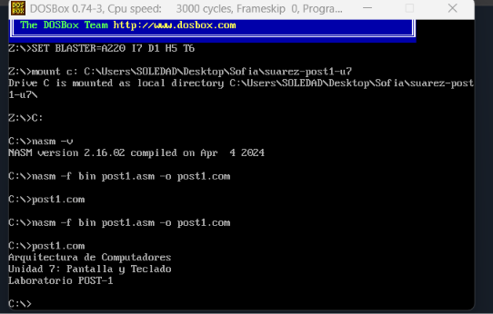
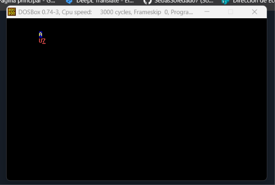
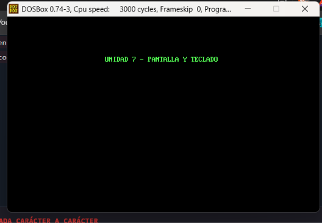
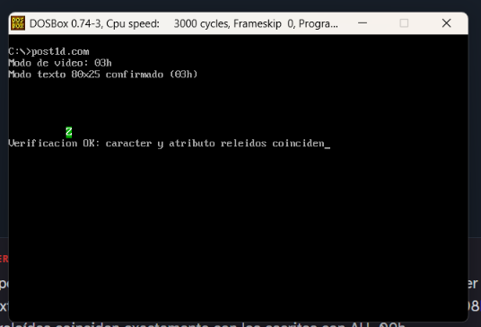
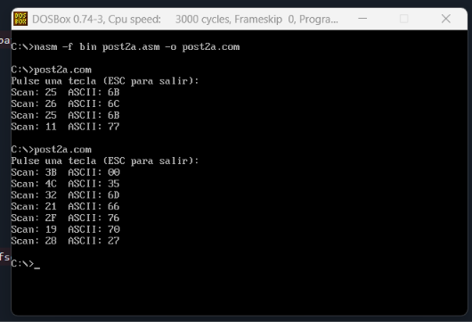
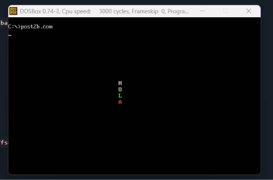
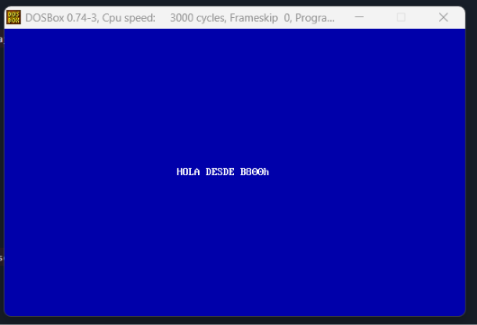
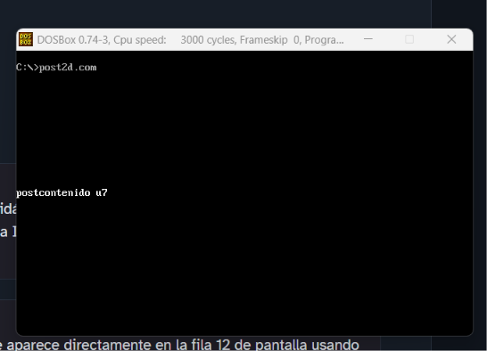
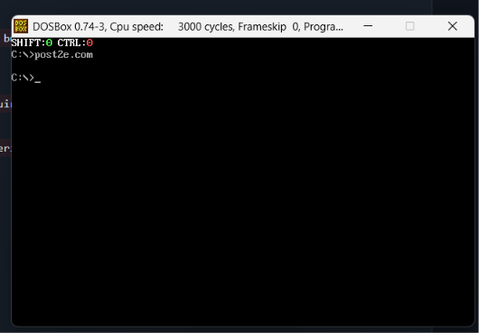

# Post-contenido Unidad 7 — Manejo de Pantalla y Teclado en NASM sobre DOSBox

**Asignatura:** Arquitectura de Computadores

Este repositorio reúne las dos partes del laboratorio: la Parte 1 (INT 21h e INT 10h) y la Parte 2 (INT 16h y acceso directo a B800h). Todos los programas se ensamblan con NASM y se ejecutan en DOSBox.

## Estructura del repositorio

```
suarez-post1-u7/
├── README.md
├── parte1/  post1.asm  post1b.asm  post1c.asm  post1d.asm  (+ .com)
├── parte2/  post2a.asm post2b.asm  post2c.asm  post2d.asm  post2e.asm (+ .com)
└── capturas/ (capturas de la ejecucion)
```

Compilación y ejecución (ejemplo): `nasm -f bin post1.asm -o post1.com` y luego `post1.com`.

---

# Capturas de pantalla

Todas están en la carpeta `capturas/` y se organizan según el programa `.asm` ejecutado.

### Parte 1

#### `parte1/post1.asm` — P1-CP1



#### `parte1/post1b.asm` — P1-CP2



#### `parte1/post1c.asm` — P1-CP3



#### `parte1/post1d.asm` — P1-CP4



### Parte 2

#### `parte2/post2a.asm` — P2-CP1



#### `parte2/post2b.asm` — P2-CP2



#### `parte2/post2c.asm` — P2-CP3



#### `parte2/post2d.asm` — P2-CP4



#### `parte2/post2e.asm` — P2-CP5



## Decisión técnica 1 — ¿INT 21h o INT 10h para esta salida de texto?

El uso de INT 21h/AH=09h es la opción apropiada cuando se imprime texto plano sin necesidad de color ni posicionamiento fino, como el encabezado de `post1.asm`: una sola llamada con DS:DX imprime toda la cadena y el sistema avanza el cursor solo. INT 21h/AH=09h no admite un atributo de color, por lo que INT 10h/AH=09h resulta obligatorio en `post1b.asm`, `post1c.asm` y `post1d.asm`, donde se exige amarillo sobre azul, verde brillante o verde de fondo en celdas exactas. Complicar con INT 10h una salida que no requiere color sería un gasto innecesario: `post1c.asm` necesita un bucle que posiciona el cursor con AH=02h y escribe con AH=09h por cada carácter, mientras que `post1.asm` resuelve lo mismo con tres llamadas. Además, el Paso 4 depende de que el modo de video soporte atributos de color únicamente en la ruta INT 10h; INT 21h nunca maneja atributos y funciona igual sin importar el modo activo.

## Decisión técnica 2 — Verificar el modo de video y releer la celda en lugar de asumir

Si el modo de video activo no fuera 03h al ejecutar `post1b.asm` y `post1c.asm`, los atributos de color podrían interpretarse de forma distinta (por ejemplo en un modo gráfico o monocromo) o la pantalla podría corromperse, porque esos programas suponen texto de 80×25 con 16 colores. INT 10h/AH=0Fh es la forma correcta de comprobarlo, ya que devuelve el modo real en AL, las columnas en AH y la página activa en BH, en lugar de dejar la suposición fija en el código. Releer la celda con AH=08h aporta otra ventaja: confirma que carácter y atributo almacenados coinciden con lo escrito y detecta si algo modificó la celda, lo que en un editor de pantalla evitaría un error silencioso de consistencia. AH=08h es portable entre modos sin conocer la aritmética segmento:offset, mientras que el acceso directo a B800h de la Parte 2 es más rápido pero exige conocer de antemano el modo y el formato de memoria.

## Decisión técnica 3 — ¿Lectura bloqueante con INT 16h o sondeo del puerto 60h?

Reemplazar AH=02h por AH=00h dentro del bucle de `post2e.asm` sería inviable, porque AH=00h bloquea la ejecución hasta que se pulse una tecla: mientras no hubiera pulsaciones, el programa dejaría de refrescar el estado de Shift y Ctrl, que debe reflejarse de forma continua incluso sin teclas en el buffer. Leer directamente el puerto 60h del controlador 8042 con `IN AL, 60h` ofrece mayor velocidad y control, pues evita la sobrecarga de la interrupción del BIOS. Sin embargo, obliga al programa a gestionar la controladora de interrupciones, a distinguir manualmente los make codes de los break codes y a lidiar con el scan code set, tareas que INT 16h resuelve automáticamente. Para un laboratorio de aplicación en DOSBox, INT 16h es la opción apropiada por su simplicidad y portabilidad. El acceso al puerto 60h sería necesario en el desarrollo de un sistema operativo propio o de un controlador de teclado, donde no existe el BIOS como intermediario.

## Decisión técnica 4 — ¿Byte de estado de AH=02h o seguimiento manual de scan codes?

AH=02h es más simple y correcto porque el BIOS mantiene el byte de estado actualizado en cada interrupción de teclado, sin que el programa tenga que rastrear nada: basta una llamada y unas máscaras de bits. El seguimiento manual de los scan codes de make y break de Shift (2Ah/AAh) y Ctrl (1Dh/9Dh) exige variables propias y un sondeo frecuente del buffer. Un error fácil de cometer es perder un código de liberación si el programa está ocupado en otra tarea cuando llega, lo que deja el modificador "atascado" como presionado; AH=02h evita ese problema por completo. Además, AH=02h ya distingue Shift izquierdo de derecho mediante los bits 1 y 0, así que sigue siendo la opción más simple. Solo sería preferible interceptar los scan codes crudos si se necesitaran eventos de transición, es decir, el instante exacto en que una tecla se presiona o se suelta, y no solo el estado actual.
